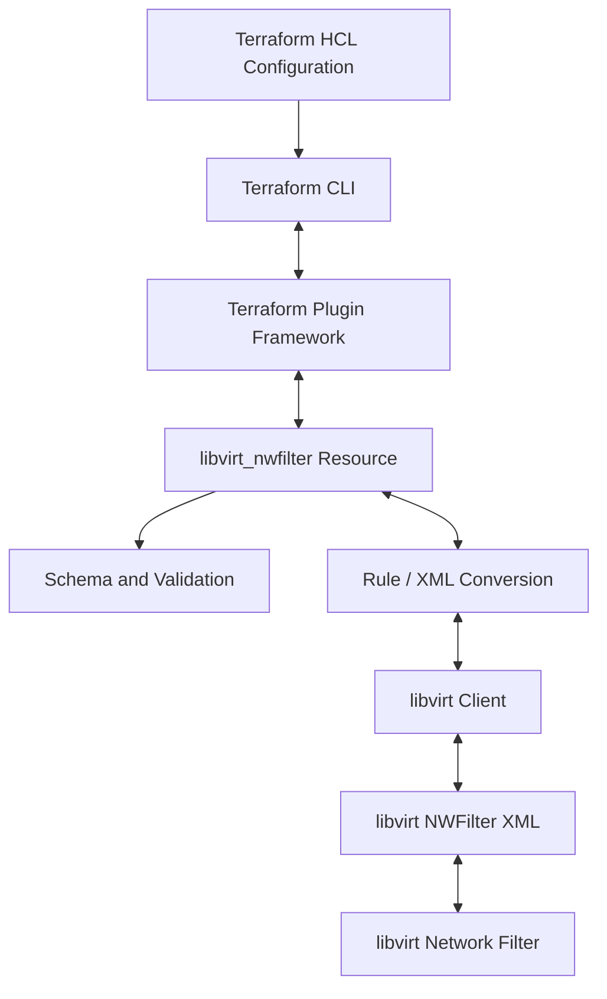
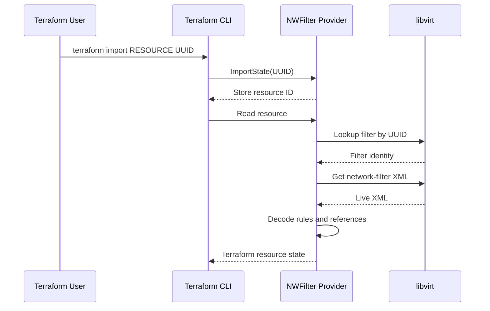
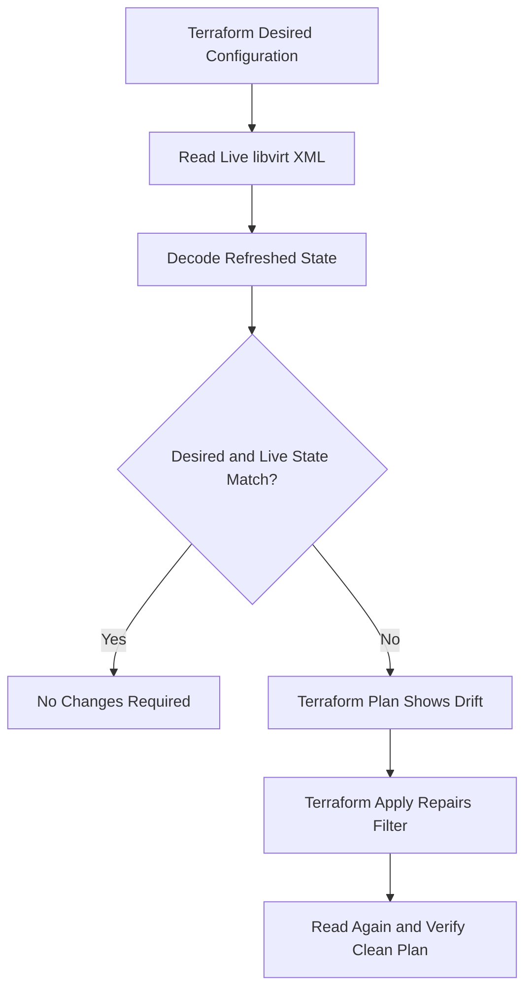

# Iteration 3 — System Architecture

## 1. Project Architecture

Team 5 extended terraform-provider-libvirt with the
`libvirt_nwfilter` Terraform resource.

The resource manages libvirt network-filter definitions through
the Terraform Plugin Framework and the libvirt API.

The network-filter definitions can be referenced by VM network
interfaces. Actual two-VM integration will be documented only
after its separate verification.

## 2. Main Components

| Component | Responsibility |
|---|---|
| Terraform CLI | Planning, applying, importing and refreshing |
| Plugin Framework | Resource schema, state and diagnostics |
| NWFilter resource | Create, Read, Update, Delete and ImportState |
| XML conversion | Convert Terraform entries to libvirt rule structures |
| XML decoder | Reconstruct Terraform state from live libvirt XML |
| libvirt client | Communicate with the libvirt API |
| libvirt NWFilter | Store network-filter policies on the host |

Implementation files include:

- `terraform-provider-libvirt/internal/provider/nwfilter_resource.go`
- `terraform-provider-libvirt/internal/provider/nwfilter_import_decode.go`
- `terraform-provider-libvirt/internal/libvirt/client.go`

## 3. Resource Lifecycle

### Create

1. Terraform reads the HCL configuration.
2. The provider validates rule criteria.
3. Terraform rule entries are converted into libvirt XML.
4. The libvirt API creates the network filter.
5. Terraform records the resulting resource identity.

### Read and Refresh

1. Terraform requests the current resource state.
2. The provider looks up the live filter in libvirt.
3. The provider reads and parses its XML.
4. Rule and reference entries are decoded into Terraform state.
5. Terraform compares refreshed state with the desired configuration.

### Update

The provider converts changed rules into a new filter definition
and updates the managed libvirt filter.

The acceptance tests verify that supported updates retain
the existing filter UUID.

### Delete

Terraform requests removal of the managed filter through libvirt.

## 4. I3-US1 — Network Filter Import

- Contributor: Ashfaaq
- Issue: #18
Pull Request: #21

Import uses the UUID to identify an existing libvirt filter.
The shared decoder reconstructs supported rule and reference
attributes from the live XML.

## 5. I3-US2 — Configuration Drift Detection and Repair

- Contributor: Jaydeep Reddy Chintham
- Issue: #19
Pull Request: #22

The drift acceptance test modifies a dedicated filter outside
Terraform, confirms a nonempty plan, applies a repair, verifies
UUID preservation, and checks the final plan.

## 6. I3-US3 — ARP and IPv6 Protocol Support

- Contributor: Haritha Reddy Medikonda
- Issue: #20
Pull Request: #23

The resource supports these additional criteria:

**ARP**
- Source and destination MAC addresses.
- Source and destination IPv4 addresses and masks.
- ARP opcode matching.
- Conversion of symbolic libvirt ARP opcodes to numeric state.

**IPv6**
- Source and destination IPv6 addresses.
- IPv6 prefix masks.
- Supported protocol identifiers.
- Validation of invalid addresses and incompatible values.

The libvirt XML conversion produces `<arp>` and `<ipv6>`
elements, while the shared decoder reconstructs their values
during Terraform refresh and import.

## 7. Testing Architecture

The team used three complementary levels of verification:

1. **Unit tests:** XML conversion and value validation.
2. **Refresh tests:** XML-to-state decoding and changed values.
3. **Acceptance tests:** Real libvirt creation, updates,
   import, drift repair, and cleanup.

The targeted NWFilter regression suite also exercised
previously implemented ICMP, TCP, UDP, IPv4, MAC,
reference, import and update functionality.

## 8. Integration Boundary

The implemented NWFilter resource manages filter definitions.
Attaching policies to VM interfaces and demonstrating network
enforcement across two VMs are separate integration activities.

The final report must distinguish:

- Implemented and tested provider features.
- Verified live libvirt NWFilter operations.
- Any separately verified VM, Ansible and GUI demonstrations.

Do not present untested two-VM or Ansible behavior as completed.

## 9. References

- `iteration3/README.md` — Sprint overview.
- `iteration3/USAGE.md` — Terraform usage instructions.
- `iteration1/README.md` — Initial NWFilter implementation.
- `iteration2/` — Prior protocol and lifecycle extensions.
- GitHub PRs #21, #22 and #23 — Iteration 3 implementation history.
